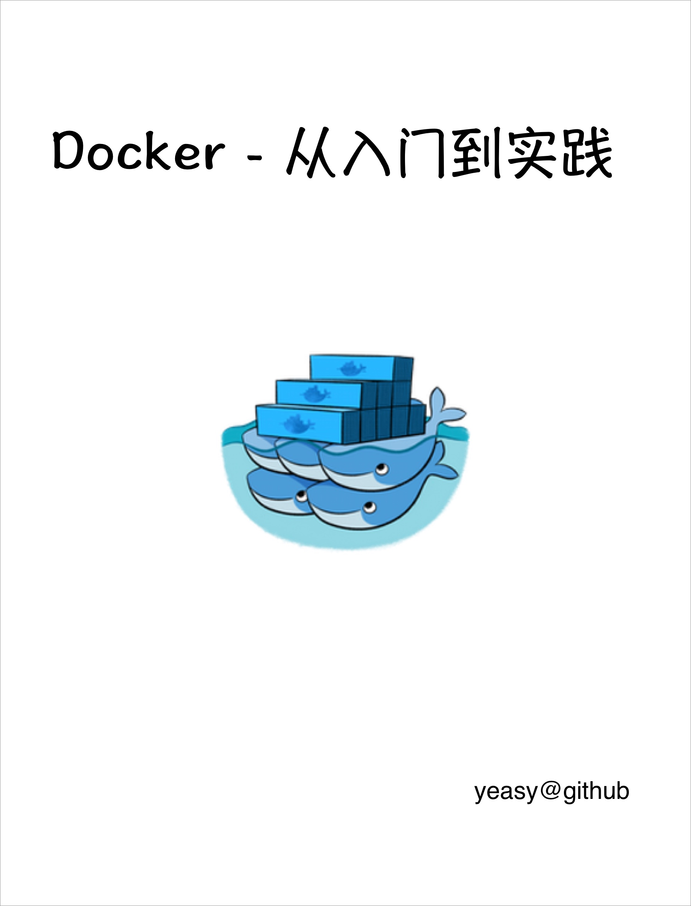

# Docker 从入门到实践

从运行第一个容器开始，学习镜像构建、多服务应用部署与 Kubernetes 编排。

**[在 GitBook 阅读第一章 · Docker 简介](https://yeasy.gitbook.io/docker_practice/di-yi-bu-fen-ru-men-pian/01_introduction)**

[全书目录（GitHub）](https://github.com/yeasy/docker_practice/blob/master/SUMMARY.md) · [正式 PDF（发布页）](https://github.com/yeasy/docker_practice/releases/latest)



## 关于本书

[Docker](https://www.docker.com) 是个划时代的开源项目，它彻底释放了计算虚拟化的威力，极大提高了应用的维护效率，降低了云计算应用开发的成本！使用 Docker，可以让应用的部署、测试和分发都变得前所未有的高效和轻松！

无论是应用开发者、运维人员、还是其他信息技术从业人员，都有必要认识和掌握 Docker，节约有限的生命。

本书既适用于具备基础 Linux 知识的 Docker 初学者，也希望可供理解原理和实现的高级用户参考。同时，书中给出的实践案例，可供在进行实际部署时借鉴。

书中内容与示例以 [Docker Engine v29.x](https://docs.docker.com/engine/release-notes/29/) 为基础。

## 从哪里开始

- **运行第一个容器** · [安装并验证 Docker](https://yeasy.gitbook.io/docker_practice/di-yi-bu-fen-ru-men-pian/03_install) 后，跟随 [1.1 快速上手](https://yeasy.gitbook.io/docker_practice/di-yi-bu-fen-ru-men-pian/01_introduction/1.1_quickstart) 构建 Nginx 镜像，启动容器并在浏览器中打开页面。
- **用 Compose 启动多服务应用** · [安装 Docker Compose](https://yeasy.gitbook.io/docker_practice/di-er-bu-fen-jin-jie-pian/11_compose/11.2_install)后，跟随[多服务应用示例](https://yeasy.gitbook.io/docker_practice/di-er-bu-fen-jin-jie-pian/11_compose/11.3_usage)启动 Flask 应用和 Redis，刷新页面验证访问计数。
- **用 Kubernetes 部署应用** · [用 kind 创建本地集群](https://yeasy.gitbook.io/docker_practice/di-san-bu-fen-shen-ru-pian/14_kubernetes_setup/14.4_kind)，再完成 [13.5 实战练习](https://yeasy.gitbook.io/docker_practice/di-san-bu-fen-shen-ru-pian/13_kubernetes_concepts/13.5_practice)，用 Deployment 部署 Nginx，通过 Service 访问并观察滚动更新。

按阶段学习、练习与自测，见[附录八 · Docker 学习路线图与知识体系](https://yeasy.gitbook.io/docker_practice/fu-lu/appendix/learning_roadmap)。

<details>

<summary>按角色选读</summary>

| 读者角色 | 学习重点 | 核心成果 |
|---------|---------|---------|
| **运维新手** | 第 1-6 章 | 掌握容器的基本概念与操作 |
| **开发者** | 第 1-8 章 → 第 11 章 | 学会容器化应用的构建与部署 |
| **DevOps 工程师** | 第 1-11 章 → 第 13-14 章 → 第 18-21 章 | 实现容器编排与自动化部署流程 |
| **架构师** | 第 1-6 章 → 第 12-17 章 → 第 18-19 章 | 设计高可用、高性能的容器基础设施 |

</details>

## 全书结构

- **入门篇（第 1–6 章）** · 从[第一章](https://yeasy.gitbook.io/docker_practice/di-yi-bu-fen-ru-men-pian/01_introduction)开始，学习镜像、容器和仓库的概念与操作。
- **进阶篇（第 7–11 章）** · 从[第七章 Dockerfile 指令详解](https://yeasy.gitbook.io/docker_practice/di-er-bu-fen-jin-jie-pian/07_dockerfile)开始，学习镜像定制、数据与网络管理、Buildx 和 Compose。
- **深入篇（第 12–17 章）** · 从[底层实现](https://yeasy.gitbook.io/docker_practice/di-san-bu-fen-shen-ru-pian/12_implementation)开始，了解 Kubernetes、Etcd、容器云服务和 Podman 等生态项目。
- **实战篇（第 18–21 章）** · 从[容器安全](https://yeasy.gitbook.io/docker_practice/di-si-bu-fen-shi-zhan-pian/18_security)开始，学习安全防护、监控与日志，以及操作系统和 CI/CD 案例。

## 延伸阅读

- [《前线部署工程实践指南》](https://yeasy.gitbook.io/forward_deployed_engineering_guide/) · 将容器、Kubernetes、GitOps、IaC、供应链、安全、观测与 SLO 组合成可交付、可审计、可运营的部署工程体系。
- 《[Docker 技术入门与实战][1]》（第 4 版） · [京东图书][1] · [天猫图书](https://detail.tmall.com/item.htm?id=997383773726&skuId=6143496614475)

<details>

<summary>更多系列图书</summary>

- [《智能体 Harness 工程指南》](https://yeasy.gitbook.io/harness_engineering_guide) · Agent 基础设施中的容器化部署与隔离。
- [《大模型安全权威指南》](https://yeasy.gitbook.io/ai_security_guide) · 容器安全与 AI 系统安全的交叉实践。
- [《区块链技术指南》](https://yeasy.gitbook.io/blockchain_guide) · 区块链节点的容器化部署。

</details>

## 反馈与贡献

欢迎在 [GitHub Issues](https://github.com/yeasy/docker_practice/issues/new/choose) 报告勘误或提出建议，也欢迎[参与项目维护](CONTRIBUTING.md)。

[修订记录](CHANGELOG.md) · [贡献者名单](https://github.com/yeasy/docker_practice/graphs/contributors)

<details>

<summary>本地阅读与 PDF 预览版</summary>

安装 [mdPress](https://github.com/yeasy/mdpress) 后，在仓库根目录启动本地预览，再打开 `http://localhost:9000`。

```bash
brew tap yeasy/tap && brew install mdpress
mdpress serve
```

[默认分支 PDF 预览版](https://github.com/yeasy/docker_practice/releases/download/preview-pdf/docker_practice.pdf)随主线更新，正式版本以发布页为准。

</details>

<details>

<summary>支持项目</summary>

欢迎鼓励项目一杯 coffee~

<p align="center">

</p>

</details>

<details>

<summary>Star History</summary>

<p align="center">
  <a href="https://star-history.com/#yeasy/docker_practice&Date">
    
  </a>
</p>

</details>

## 许可证

本书采用 [CC BY-NC-SA 4.0](https://creativecommons.org/licenses/by-nc-sa/4.0/) 许可证。

您可以自由分享和演绎，但需署名、非商业使用、相同方式共享。

[1]: https://item.jd.com/10200902362001.html
